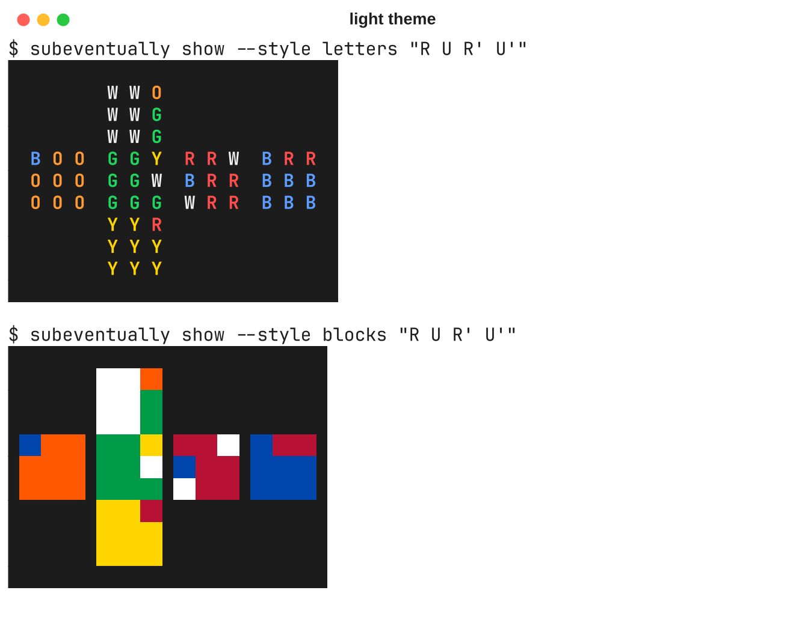
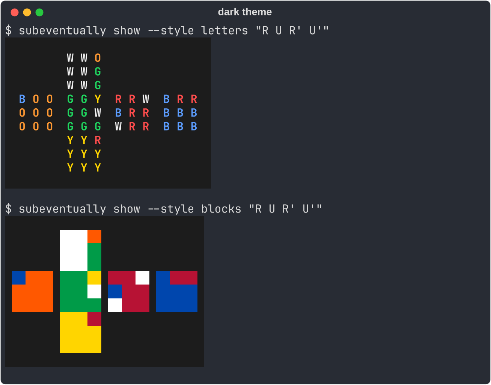

# subeventually

*Sub-20. Sub-15. Sub-10. Eventually.*

A self-hosted speedcubing platform built around a **cubing assistant**. After each solve, the assistant works out the best solve possible with every algorithm, and the best solve possible with *the algorithms you actually know*. It then shows where the time went and which algorithm is worth learning next.

> **Status:** early development (Phase 1, terminal app). So far it can show you a cube. Solving it is still on you.

## Planned features

- **Two reference solves per scramble:** full repertoire and your repertoire, with lost time split into execution, planning and knowledge gaps.
- **Learn-next ranking:** which algorithm saves you the most time on average, and which one removes your worst solves.
- **Method plugins:** Beginner, LAU and CFOP first; new methods without touching the core.
- **Algorithm sets as YAML files**, validated automatically.
- **Guided solve review:** a few quick questions (F2L order, OLL case...) instead of a full reconstruction, which remains available as an advanced option.
- **Later:** timer, sessions and statistics in a web app, multi-user self-hosting with Docker, an offline-first Android app, and data-driven improvements to the assistant.

## Repository layout

```
packages/
  core/   subeventually-core: cube model, notation, methods, solver, analysis
  tui/    subeventually: terminal app
docs/     vision, architecture, roadmap, decision records
```

## Try it

You need [`uv`](https://docs.astral.sh/uv/). From a clone of the repository:

```bash
uv sync
uv run subeventually show "R U R' U'"
```

This prints the cube after the moves as an unfolded net, starting from white on top and green in front. There are two styles:

- `letters` (the default): one bold letter per sticker, in its color (W white, Y yellow, G green, B blue, R red, O orange);
- `blocks`: one colored square per sticker, with `--style blocks`.

Both are drawn on their own dark background, so white and yellow stay readable whatever your terminal theme. Here they are in a light and in a dark terminal:

<p>
  
  
</p>

When the output is not a color terminal (piped to a file, or with `NO_COLOR` set), it falls back to plain text with the face letters of the [facelet string](docs/NOTATION.md#facelets).

## Documentation

- [Vision](docs/VISION.md): goals, phases, non-goals
- [Architecture](docs/ARCHITECTURE.md): how the assistant works
- [Roadmap](docs/ROADMAP.md): milestones
- [Decision records](docs/adr/): why things are the way they are

## Contributing

See [CONTRIBUTING.md](CONTRIBUTING.md).

## License

See [LICENSE](LICENSE).
